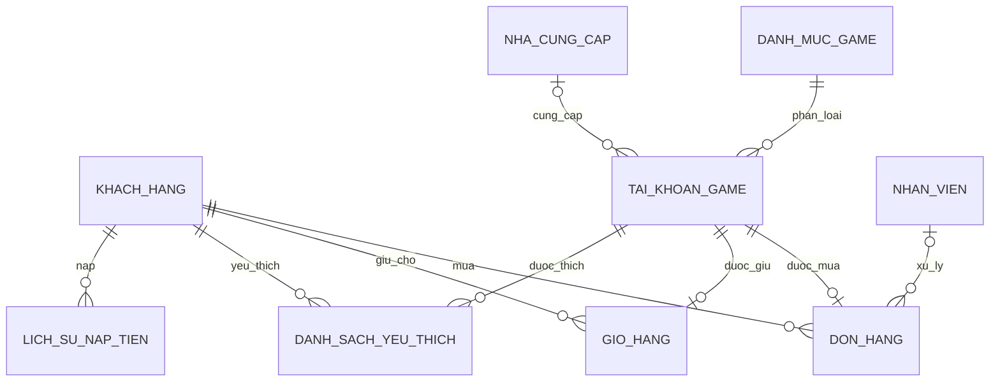

# Thiết kế PostgreSQL

## Bảng và quan hệ

Chín bảng core trong `quan_ly_shop`:

| Bảng | Mục đích |
|---|---|
| `khach_hang` | Khách, SĐT, ví |
| `danh_muc_game` | Danh mục game |
| `nha_cung_cap` | Nhà cung cấp |
| `nhan_vien` | Nhân viên, lương và mật khẩu riêng tư |
| `tai_khoan_game` | Nick, JSONB metadata, giá, credentials |
| `don_hang` | Đơn mua thành công; một nick chỉ có một đơn |
| `danh_sach_yeu_thich` | PK `(ma_kh, ma_nick)` |
| `gio_hang` | Một nick chỉ có một người giữ chỗ; TTL mặc định 15 phút |
| `lich_su_nap_tien` | Mã giao dịch duy nhất, trạng thái và thông tin đối soát |

Bảng hỗ trợ: `app_principals`, `don_hang_lich_su` phân mảnh;
`ai_analytics.log_ai_ocr`, `ai_analytics.khach_hang_marketing`.

## Ràng buộc

SĐT CHECK `^0[0-9]{9}$`, giá CHECK `> 0`, ví CHECK `>= 0`.
Các FK đơn → khách/nick và nick → game dùng RESTRICT. Wishlist/cart dùng
CASCADE. Card fingerprint có unique partial index để chống nạp lặp.
Mã đơn và tiền không nhận trực tiếp từ frontend khi checkout.

## Views và bảo mật

- `vw_catalog_nick`: thông tin công khai; password/email luôn NULL.
- `vw_bao_cao_doanh_thu`: nối đơn, khách, nick, game.
- `mv_nick_hot_trang_chu`: nick chưa bán, giá không quá 300.000đ;
  cần REFRESH khi muốn cập nhật snapshot.
- `vw_lich_su_bien_dong_vi`: UNION ALL nạp (+) và mua (-), lọc theo GUC.
- `vw_lich_su_nap_staff`: sáu cột vắn tắt, không mã thẻ/số dư.

`KhachHangRole` đọc credentials bảng gốc theo ownership trong `don_hang`
và nick không `Khoa_tranh_chap`. Public catalog đi qua view che cột.
`NhanVienSale` không SELECT lương/pass, không DELETE nick, không UPDATE ví;
chỉ UPDATE các cột public đã cấp. `ShopAdmin` phục vụ quyền quản trị nghiệp vụ;
bảng xác thực dành riêng cho trusted service login.

## Index và MVCC

- B-tree SĐT; partial `idx_nick_san_co` cho `Chua_ban`.
- GIN `idx_gin_thong_tin_nick` hỗ trợ JSONB `@>`.
- Index theo khách cho wishlist/cart/nạp tiền.
- Range partition `don_hang_lich_su` theo `ngay_tao`: năm 2025 và 2026,
  cận trên không bao gồm. Cần thêm partition trước năm 2027.
- Trigger INSERT gửi `NEW_NICK_INSERTED` qua `kenh_ai_garena` sau commit.

Chạy `database/01..04` theo thứ tự bằng `scripts/init_database.py`.
`05_maintenance_vacuum.sql` có VACUUM và hướng dẫn backup/restore; chạy
ngoài transaction. VACUUM FULL khóa bảng, không tự chạy lúc khởi động.
